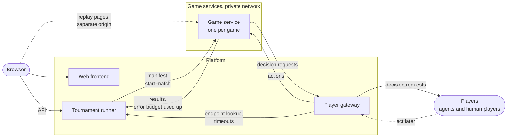

# Architecture

How the parts of Arcturus fit together. This page describes the current picture and is kept up to date. The reasons behind it are in the ADRs in [`adr/`](./adr/), and the terms are defined in [GLOSSARY.md](./GLOSSARY.md).

## Technology

Everything in this repository is TypeScript. Games and agents in other languages live in their own repositories and connect through the protocols.

| Part                 | Choice                                                                               | ADR                                                              |
| -------------------- | ------------------------------------------------------------------------------------ | ---------------------------------------------------------------- |
| Language and runtime | TypeScript on Node                                                                   | [0007](./adr/0007-write-the-repository-in-typescript-on-node.md) |
| Database             | PostgreSQL, one database per service                                                 | [0008](./adr/0008-store-service-data-in-postgresql.md)           |
| HTTP framework       | Hono for every service, wired by hand with no DI container                           | [0009](./adr/0009-build-every-service-with-hono.md)              |
| Validation           | zod at every boundary                                                                | [0010](./adr/0010-use-zod-as-the-only-schema-library.md)         |
| Database access      | Slonik, plain SQL with rows validated by zod                                         | [0011](./adr/0011-access-postgresql-with-slonik.md)              |
| Background jobs      | graphile-worker, queued in the same transaction as the data                          | [0012](./adr/0012-run-background-jobs-with-graphile-worker.md)   |
| Migrations           | Graphile Migrate, plain SQL, forward-only                                            | [0013](./adr/0013-migrate-databases-with-graphile-migrate.md)    |
| Web frontend         | React SPA on Vite: Mantine, TanStack Router, TanStack Query with Hono's RPC client   | [0014](./adr/0014-build-the-frontend-as-a-react-spa.md)          |
| Translations         | react-i18next, English only for now                                                  | [0015](./adr/0015-set-up-translations-from-the-start.md)         |
| Repository layout    | pnpm package-based workspaces, a `package.json` per package                          | [0016](./adr/0016-organise-the-repository-as-pnpm-workspaces.md) |
| Build tooling        | Vite+ (`vp`): Vitest, Oxlint, Oxfmt, type checks in `vp check`; no Nx                | [0017](./adr/0017-build-test-lint-and-format-with-vite-plus.md)  |
| Running TypeScript   | Services and libraries run from source with Node's type stripping, ESM only          | [0018](./adr/0018-run-typescript-source-directly.md)             |
| CI                   | PR and main workflows calling a reusable quality-check workflow                      | [0019](./adr/0019-compose-ci-from-reusable-workflows.md)         |
| Supply chain         | One-week release age, no trust downgrades, reviewed build scripts, CI pinned by SHA  | [0020](./adr/0020-guard-the-dependency-supply-chain.md)          |
| Service structure    | Vertical slices behind a task-based API; explicit transactions; thrown domain errors | [0021](./adr/0021-structure-services-as-vertical-slices.md)      |

Observability, local development and authentication are not decided yet.

## Components

| Component             | Owns                                                                                 |
| --------------------- | ------------------------------------------------------------------------------------ |
| **Tournament runner** | Users, tournaments, the player registry (including house agents), results, standings |
| **Player gateway**    | The log of decision requests and responses                                           |
| **Game service**      | The state of each of its matches                                                     |
| **Web frontend**      | Nothing; it calls only the tournament runner                                         |

Each service owns its data, and no service reads another's database. Players are external: users register them at runtime, and only the player gateway contacts them. Game services are deployed by the operator beside the platform, on a private network.

## Interactions

All communication is HTTP with JSON. Work that may take a while is accepted with `202 Accepted` and completed by a callback, delivered at least once, so receivers are idempotent. There is no message broker.

1. **Browser → tournament runner:** everything the web frontend does.
2. **Tournament runner → game service:** fetch the game's manifest at startup.
3. **Tournament runner → game service:** start a match with its players. Every match belongs to a tournament.
4. **Game service → player gateway → player:** a decision request, delivered by the gateway; the gateway calls the game service back with the action.
5. **Player → player gateway:** submit an action later (human players, slow agents).
6. **Player gateway → tournament runner:** look up a player's endpoint; report that a player timed out.
7. **Game service → tournament runner:** report the match result, or that a player used up its error budget.
8. **Browser → game service:** replay pages of finished matches only, from a separate origin.

When a player fails, the tournament runner decides what happens to the match. That policy is not yet decided.

## Extending Arcturus

Games and players are added by implementing the **game protocol** or the **player protocol**. Core games and agents use only these protocols, never platform internals.

## Decisions

- [Build Arcturus as independent services connected by HTTP](./adr/0001-build-arcturus-as-services-connected-by-http.md)
- [Give game services ownership of their match state](./adr/0002-give-game-services-ownership-of-match-state.md)
- [Deliver decision requests through a separate player gateway](./adr/0003-deliver-decision-requests-through-a-player-gateway.md)
- [Extend Arcturus only through published protocols](./adr/0004-extend-arcturus-through-published-protocols.md)
- [Co-host game services with the platform and register players at runtime](./adr/0005-co-host-game-services-and-register-players-at-runtime.md)
- [Show replays from the game's own page on a separate origin](./adr/0006-show-replays-from-game-pages-on-a-separate-origin.md)
- [Write the repository in TypeScript on Node](./adr/0007-write-the-repository-in-typescript-on-node.md)
- [Store service data in PostgreSQL](./adr/0008-store-service-data-in-postgresql.md)
- [Build every service with Hono, wired by hand](./adr/0009-build-every-service-with-hono.md)
- [Use zod as the only schema library](./adr/0010-use-zod-as-the-only-schema-library.md)
- [Access PostgreSQL with Slonik](./adr/0011-access-postgresql-with-slonik.md)
- [Run background jobs with graphile-worker](./adr/0012-run-background-jobs-with-graphile-worker.md)
- [Migrate databases with Graphile Migrate](./adr/0013-migrate-databases-with-graphile-migrate.md)
- [Build the frontend as a React single-page app](./adr/0014-build-the-frontend-as-a-react-spa.md)
- [Set up translations from the start](./adr/0015-set-up-translations-from-the-start.md)
- [Organise the repository as pnpm package-based workspaces](./adr/0016-organise-the-repository-as-pnpm-workspaces.md)
- [Build, test, lint and format with Vite+](./adr/0017-build-test-lint-and-format-with-vite-plus.md)
- [Run TypeScript source directly, with no build step](./adr/0018-run-typescript-source-directly.md)
- [Compose CI from reusable workflows](./adr/0019-compose-ci-from-reusable-workflows.md)
- [Guard the dependency supply chain](./adr/0020-guard-the-dependency-supply-chain.md)
- [Structure services as vertical slices with a task-based API](./adr/0021-structure-services-as-vertical-slices.md)
- [Open database transactions explicitly in handlers](./adr/0022-open-database-transactions-explicitly-in-handlers.md)
- [Serialise work on a match with a row lock](./adr/0023-serialise-work-on-a-match-with-a-row-lock.md)
- [Signal expected failures with thrown domain errors](./adr/0024-signal-expected-failures-with-thrown-domain-errors.md)
